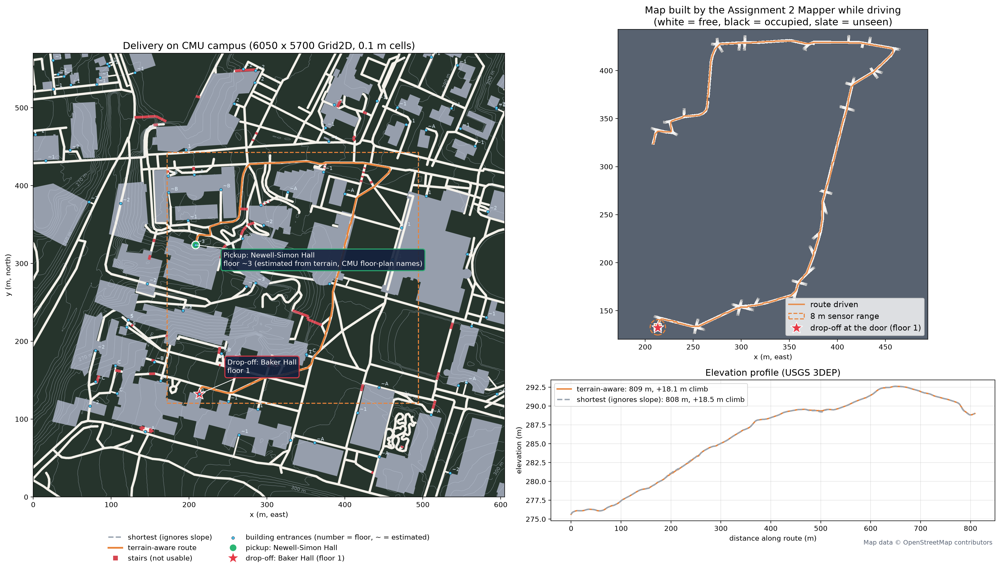

# Campus Delivery Robot (16-362 project)

A delivery robot that drives between CMU buildings on a simulated campus map:
sidewalks from OpenStreetMap, real ground elevation from USGS 3DEP, no stairs,
slope-aware A* routing, delivery to building entrances (with floors), and
mapping with the Assignment 2 occupancy-grid code.



## Files

| File | What it does |
|---|---|
| `make_campus_map.py` | Builds the campus map: downloads OpenStreetMap paths, buildings and entrances plus USGS elevation, removes stairs, finds each building's delivery points and their floors. Writes `maps/`. |
| `campus_grid.py` | Loads the map into the Assignment 2 `Grid2D`, plans routes with A* (slope and climb aware), and runs a demo delivery that maps the route with the Assignment 2 Mapper. |
| `test_campus_grid.py`, `test_campus_map.py` | Checks the map, entrances, stairs, slopes and routes. |
| `maps/floor_overrides.json` | Door floors set by hand (they win over everything else). |

## Setup

This code imports the Assignment 2 mapping code (`Grid2D`, `Sensor`,
`Observer`, `Mapper`) from a sibling folder, which is **not** in this repo
(course rule: do not share assignment solutions publicly). Put your own
`assignment2-handout` next to this folder:

```
mral/
  assignment2-handout/   <- your Assignment 2 (mapper_py/...)
  delivery_robot/        <- this repo
```

Then, from this folder:

```
python -m venv .venv
.\.venv\Scripts\Activate.ps1          # Windows PowerShell (source .venv/bin/activate elsewhere)
pip install -r requirements.txt
```

## Run

```
python make_campus_map.py      # build the map (first run downloads data, a few minutes)
python campus_grid.py          # asks for pickup / drop-off buildings and (optional) floors
python campus_grid.py --list   # buildings and their floors
python campus_grid.py --from "ANSYS Hall" --from-floor C --to "Tepper" --floor 1
python test_campus_grid.py     # checks
```

Floor names come from OpenStreetMap door tags, hand overrides, and CMU's
official floor lists (`maps/cmu_floor_plans.json`, kept out of the repo
because the source requires an Andrew ID; without it, floors are numbered
from terrain). Floors marked `~` are estimates.

## Data

Map data © OpenStreetMap contributors (ODbL). Elevation: USGS 3D Elevation
Program (public domain).
